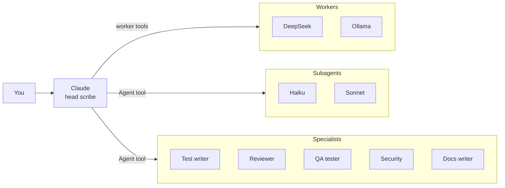

# Scriptorium

A multi-agent workspace for Claude Code. Claude is the head scribe: you talk to it, and it hands work to a team of cheaper models, subagents and specialists when that helps. Everyone's work shows up live in an isometric, pixel-art office library.


**Why:** to save Claude usage and get better results. Routine code goes to cheap DeepSeek or free local models, searching to a light Haiku subagent, and every finished change can be tested and reviewed with fresh eyes before you see it.

## Quick start

You need [Node.js 22.9+](https://nodejs.org) and a Claude subscription (Pro or Max).

```bash
git clone https://github.com/AkbulutMirac/scriptorium.git
cd scriptorium
npm install
npm run app
```

Open http://localhost:7777. On first launch a **Setup** window walks you through:

1. **Claude account:** "Sign in with Claude" opens Anthropic's sign-in page. Scriptorium brings its own copy of Claude Code.
2. **DeepSeek (optional):** paste an API key from [platform.deepseek.com](https://platform.deepseek.com/api_keys). It is tested, then stored only in `.env` on this computer.
3. **Local models (optional):** install [Ollama](https://ollama.com/download), pull a model (e.g. `ollama pull qwen3.5:9b`) and add it as a worker with one click.
4. **Other Claude Code sessions (optional):** make the team available in your terminal and the Claude desktop app too (see [Outside Scriptorium](#outside-scriptorium)).

Setup can be reopened from the Settings menu. No `.env` is needed: everything has a default.

**Windows shortcut** (runs without a console window, stops from Settings → "Quit Scriptorium"):

```bash
powershell -ExecutionPolicy Bypass -File scripts\CreateShortcut.ps1
```

## The team



| Member | Runs on | Good at | Can it touch files? |
|---|---|---|---|
| **DeepSeek** Flash / Pro | DeepSeek API, cheap | Self-contained code, summaries, classification; Flash reads images | No, Claude passes the files and applies the answer |
| **Local workers** | Ollama on your GPU, free | Short jobs and anything confidential | No |
| **Haiku** | Your Claude subscription | Searching and reading the codebase | Yes |
| **Sonnet** | Your Claude subscription | Changes across several files, running tests | Yes |
| **Test writer** | Sonnet | Writes and runs tests for a change | Test files only |
| **Reviewer** | Opus | Reviews a finished change with fresh eyes | Read-only |
| **QA tester** | Sonnet | Checks the UI in a real browser, verifies each finding | Read-only |
| **Security** | Sonnet + `security-audit` skill | Changes touching input, auth, files, shell, network, secrets | Read-only |
| **Docs writer** | Sonnet | Updates README and docs at the end | Docs only |

How Claude uses them:

- **Claude decides.** Nothing is mandatory; the helper notes ([docs/CLAUDE-workers.md](docs/CLAUDE-workers.md)) describe when each one fits, and each specialist's description says when to call it.
- **Every subagent ends with a report**, which is its answer to Claude. The reviewer's ends with a verdict (Approve / Changes needed) and must fix, should fix and nits at `file:line`; the test writer's with pass/fail and the likely cause of each failure.
- **A typical change:** Claude writes it, the test writer and reviewer check it in parallel, Claude fixes what they found, then QA or security if relevant, and the docs writer last.
- The **?** button in the top bar explains the team in short.

The specialists are plain Claude Code agent files in [`agents/`](agents), easy to read and change.

## Features

**Chat with Claude**
- Runs on Claude Code: your CLAUDE.md, MCP servers, skills and plugins work as in the terminal.
- Streaming answers, thinking, tool cards with diffs, permission prompts and multiple-choice questions.
- Side chats, quoting replies, a session panel (folder, git changes, context, connectors, background tasks).
- Attach files and images, slash commands, model, effort, fast mode and permission mode under the input.
- Subscription usage limits in the top bar; history grouped by project and shared with your terminal sessions.

**Workers and helpers**
- Chat with any worker, Haiku or Sonnet directly, with images and files, model and thinking settings.
- Every task Claude hands out lands in that helper's history under "From Claude", with the answer or report.
- Add, edit and remove DeepSeek and Ollama workers from the UI. Confidential tasks (`sensitive`) only go to local workers.
- **QA tools** drive a real headless Edge/Chrome: `qa_sweep` clicks every visible control on desktop, tablet and phone and measures overflow, cut-off text, overlaps, tap targets and console errors; `qa_explore` explores flows on its own. They only test local addresses and never press send, delete, sign-in or quit buttons.

**The office**
- Claude sits at the head desk; workers have their own desks and rest in the lounge when idle.
- Subagents and specialists walk in through the door while they work and leave when done. Several jobs for the same worker show up as several copies.
- Hover over anyone to see their task, project and how long it has been running.
- Light, dark or system theme, 6 accent colors and a pixel mode.

## Outside Scriptorium

The team also works in Claude Code sessions in your terminal and the Claude desktop app. In Setup step 4:

- **Worker tools:** registers Scriptorium's MCP server (`http://127.0.0.1:7777/mcp`).
- **Specialists:** copies the agent files to `~/.claude/agents/scriptorium/`.
- **Office hooks:** adds Claude Code hooks so those sessions' subagents show up in the office and get the report request.
- **Helper notes (optional):** adds the notes to `~/.claude/CLAUDE.md`. Sessions opened in Scriptorium always have them.

Scriptorium has to be running for the worker tools: one server keeps the DeepSeek key in one place, gives every session the same local model queue and lets the office see every task. Subagents run inside Claude Code; Scriptorium only follows them through the hooks.

To list the workers in the Claude desktop app under Settings → Desktop app → Local MCP servers, add this to `claude_desktop_config.json` and restart the app:

```json
"mcpServers": {
  "scriptorium": { "command": "npx", "args": ["-y", "mcp-remote", "http://127.0.0.1:7777/mcp"] }
}
```

## Settings (`.env`, all optional)

| Setting | Description |
|---|---|
| `DEEPSEEK_API_KEY` | For DeepSeek workers (Setup writes it for you) |
| `CLAUDE_CODE_PATH` | Path to your own `claude` install. Empty means Scriptorium's own copy. |
| `CLAUDE_CWD` | Claude's default working folder (also changeable in the UI) |
| `PROJECTS_DIR` | Where your project folders live. Listed automatically in the folder picker and history. |
| `PROJECTS_EXCLUDE` | Folders to hide from the lists (names or full paths, comma-separated). Folders are never touched. |
| `OLLAMA_BASE_URL` | If Ollama runs at another address |
| `WORKER_MAX_TOKENS` | Optional cap on output tokens per worker call. Empty: the provider's default. Thinking tokens count too. |
| `PORT` | Backend port (default 7777) |

## Choosing a local model

Local workers get short, single-step tasks. A model is fast when it fits entirely in your GPU memory:

- **8 GB GPU:** `qwen3.5:9b` (6.6 GB) is fast. Stronger but slower: `hf.co/ISTA-DASLab/Qwen3.8-27B-GSQ-RCO-GGUF:IQ2_S` (9.3 GB), about 3.7 tokens/s on an RTX 4060 Laptop.
- **12 GB and up:** 14B–27B models.

For a model you won't send images to, removing Ollama's vision module makes it faster:

```bash
ollama show --modelfile <model> > model.Modelfile
```

Delete the second `FROM` line in `model.Modelfile` (add `PARAMETER num_ctx 16384` for a larger context), then:

```bash
ollama create <new-name> -f model.Modelfile
```

Thinking is off by default for local workers; turn it on from the menu under the worker's input.

## Development

```bash
npm run dev        # http://localhost:5173, the server restarts on code changes
```

```bash
npm run typecheck
```

```bash
npm run cli        # try it from the terminal (/side <message> opens a side chat)
```

Design notes: [docs/PLAN.md](docs/PLAN.md)

## Security

- The backend listens only on this computer (`127.0.0.1`). The WebSocket, MCP and hook endpoints accept requests only from this computer and the app's own origins, so other sites in your browser can't control Claude or the workers.
- API keys live only in `.env`, never go into the repo and are never sent back to the UI.
- In "Ask every time" mode, Claude's commands and file changes wait for your approval in the UI.
- Data sent to DeepSeek goes to DeepSeek's servers. For confidential tasks use `sensitive: true` and a local worker.

## License

[MIT](LICENSE)
