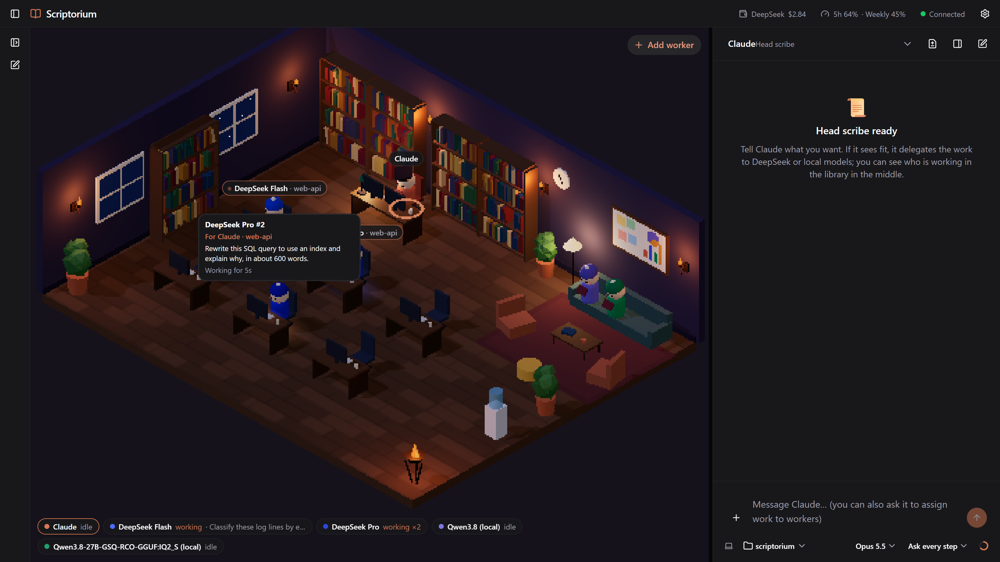
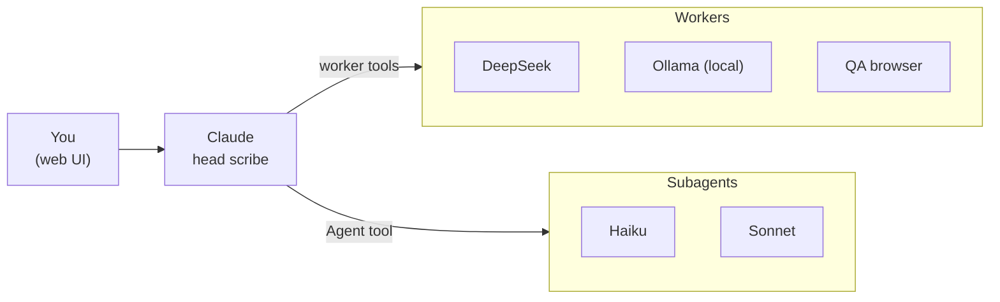
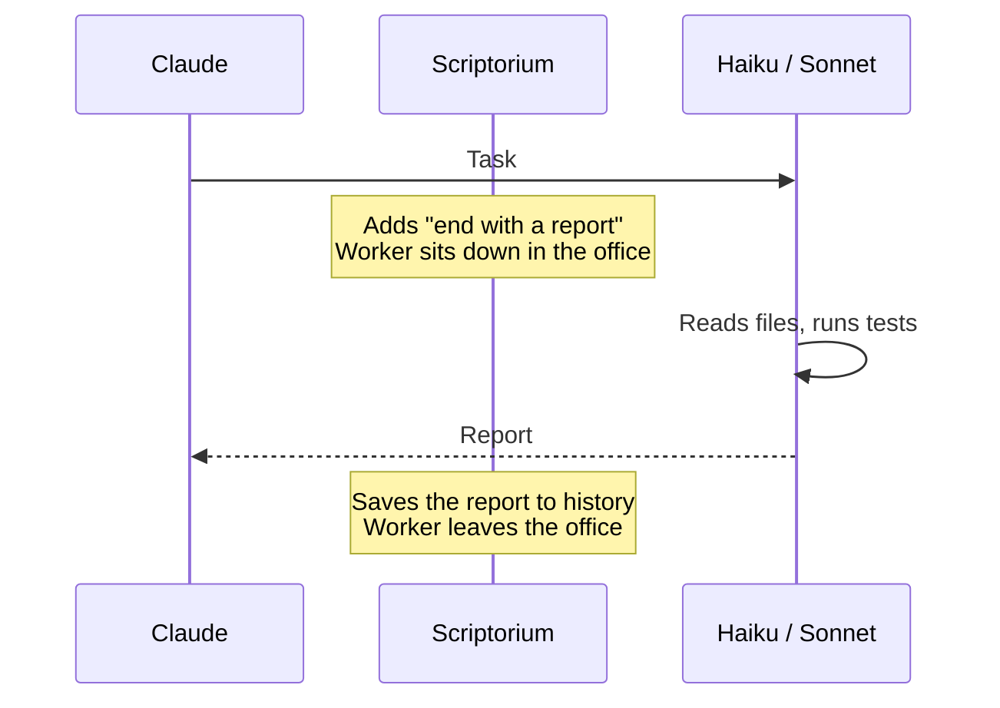

# Scriptorium

Claude is the head scribe; DeepSeek, local LLMs and Claude's own Haiku and Sonnet subagents are the scribes. A multi-agent workspace where you can talk to all of them from one interface, and Claude hands work to the others on its own judgment. Who is doing what shows up live in an isometric, pixel-art office library.



**Why:** to save Claude usage. Claude can give well-defined coding tasks, summaries and classification to cheap DeepSeek or free local models, and searching or multi-file work to lighter Haiku and Sonnet subagents, then check the result itself. It decides when that is worth it.

## Quick start

All you need is [Node.js 22.9+](https://nodejs.org) and a Claude subscription (Pro or Max).

```bash
git clone https://github.com/AkbulutMirac/scriptorium.git
cd scriptorium
npm install
npm run app
```

Open http://localhost:7777. On first launch a **Setup** window walks you through everything:

1. **Claude account:** "Sign in with Claude" opens Anthropic's sign-in page in your browser. You don't need to install Claude Code separately; Scriptorium uses its own copy.
2. **DeepSeek (optional):** create an API key at [platform.deepseek.com](https://platform.deepseek.com/api_keys) and paste it. The key is tested first and, if it works, written only to the `.env` file on this computer.
3. **Local models (optional):** install [Ollama](https://ollama.com/download) and pull a model (for example `ollama pull qwen3.5:9b`). Add any installed model as a worker with one click.
4. **Every Claude Code session (optional):** one click lets Claude in your terminal and in the Claude desktop app use the workers too, by adding the worker tools. Another click adds hooks so their Haiku and Sonnet subagents show up in the office. Sessions opened in Scriptorium always get the helper notes; adding them to `~/.claude/CLAUDE.md` as well is a separate, optional click.

You can reopen the Setup window from the Settings menu.

**No `.env` needed:** everything has a default. Setup creates `.env` when you save a DeepSeek key. To change other settings, copy `.env.example` to `.env` and edit it.

**Windows shortcut:** to put a desktop shortcut that runs without a console window:

```bash
powershell -ExecutionPolicy Bypass -File scripts\CreateShortcut.ps1
```

On first launch the shortcut installs the packages, builds the UI, starts the server in the background and opens the browser. If the server is already running, it just opens the browser. To stop it, use Settings → "Quit Scriptorium" in the app. Output goes to `server\data\*.log`.

## Features

**Claude (head scribe)**
- Connects to Claude Code. CLAUDE.md, MCP servers, skills and plugins are the same as in your terminal. New Claude Code features arrive as it updates.
- Streaming answers, thinking blocks, tool cards (red/green diff for Edit and Write), permission prompts and answering multiple-choice questions.
- Consecutive tool calls fold into one row ("Read 3 files, ran 2 commands") that expands on click. While Claude works, a status line shows what it is doing right now and for how long.
- **Side chat:** open a separate conversation about a message without disturbing the main one. Reply to a message with a quote.
- **Session info panel:** folder and git branch, extra folders, context usage, connectors (toggle, reconnect), written files, git changes (diff), background tasks.
- **"+" menu:** attach files or images (paste and drag-and-drop too), add folders, slash commands (suggested as you type `/`), connectors and plugins.
- A bar under the input like in the Claude app: working folder picker, model, effort (Low–Max) and fast mode, permission mode, usage ring.
- Claude subscription usage limits in the top bar (5-hour and weekly).
- History grouped by project, shared with your terminal Claude Code sessions. The app reopens the chat you had open last.

**Workers (DeepSeek, Ollama)**
- Chat with any worker directly. Attach images and files (DeepSeek also reads PDFs).
- Under the input: model, thinking level, temperature, max tokens, JSON output, system prompt, token usage and context usage.
- Claude delegates with tools: `ask_worker` waits for the answer, `start_job` and `job_status` run in the background.
- The tools also work in every Claude Code session in your terminal and the desktop app.
- Several sessions can use the same worker at once. In the 3D office a copy of the worker walks in for each task, sits at a spare desk and leaves when it's done. Local workers do one task at a time; the rest wait in line.
- Hover over a worker to see which task it is doing, for which project, and for how long.
- **QA tools** drive a real headless Edge/Chrome on your computer: `qa_sweep` clicks every visible control in desktop, tablet and phone sizes and measures overflow, cut-off text, overlaps, small tap targets and console errors; `qa_explore` is an agent that looks at the screen and decides what to try next. The QA worker reviews the screenshots; reports go to `server/data/qa/`. They only test local addresses and never press buttons that send, delete, rename, sign in/out or quit.
- Every task Claude delegates (from any session) lands in that worker's history under "From Claude", with the answer and token usage. You can continue it as a chat.
- Sensitive data (`sensitive`) only goes to local workers.
- Add, edit and delete workers from the UI (`server/agents.json`). DeepSeek Flash and Pro come by default.
- Remaining DeepSeek balance in the top bar.

**Haiku and Sonnet (Claude subagents)**
- Two more workers in the office. Claude starts them itself with its Agent tool (`model: "haiku"` or `"sonnet"`) when it thinks they help: Haiku for searching and reading code, Sonnet for changes across several files with tests. Unlike DeepSeek they can read files and run commands. They use your Claude subscription.
- Every subagent is asked to end with a short report (Done, Files, Checks, Open). That report is its answer to Claude, and it also lands in the worker's history under "From Claude" with the task.
- While a subagent runs, its worker sits at a desk in the 3D office and leaves when it is done.
- Works in sessions opened in Scriptorium out of the box. For terminal and desktop app sessions, add the hooks in Setup step 4.
- You can also chat with Haiku and Sonnet directly, like with DeepSeek: a plain chat (no tools) with images and PDFs.

**Interface:** React, HeroUI v3 and react-three-fiber. Light, dark or system theme, 6 accent colors, pixel mode.

## How it works



Everything runs on your computer through one Scriptorium server. The 3D office shows every worker and subagent while it works.

**Scriptorium has to be running for the worker tools to work.** Other Claude Code sessions reach the workers through `http://127.0.0.1:7777/mcp`, so when Scriptorium is closed the tools are simply missing there. Keeping one server means the DeepSeek key stays in one place, all sessions share the local model queue, and the 3D office sees every task.

**Helper notes** (`docs/CLAUDE-workers.md`) describe the team and when each helper fits. They are always given to sessions opened from Scriptorium; Claude decides whether to use a helper at all. Other sessions only get the tools, unless you also add the notes to `~/.claude/CLAUDE.md` from Setup.

### How a subagent works



Subagents run inside Claude Code. Scriptorium only watches them through Claude Code hooks.

Only subagents started with an explicit `model` of `haiku` or `sonnet` appear in the office. Every subagent gets the report request, whatever its model.

**Claude desktop app:** to see the workers under Settings → Desktop app → Local MCP servers, add this to `claude_desktop_config.json` and restart the app:

```json
"mcpServers": {
  "scriptorium": { "command": "npx", "args": ["-y", "mcp-remote", "http://127.0.0.1:7777/mcp"] }
}
```

## Settings (`.env`, all optional)

| Setting | Description |
|---|---|
| `DEEPSEEK_API_KEY` | For DeepSeek workers (Setup writes it for you) |
| `CLAUDE_CODE_PATH` | Path to your own `claude` install. Empty means Scriptorium's own copy. |
| `CLAUDE_CWD` | Claude's default working folder (also changeable in the UI) |
| `PROJECTS_DIR` | Where your project folders live. Listed automatically in the folder picker and history. |
| `PROJECTS_EXCLUDE` | Folders to hide from the lists entirely (names or full paths, comma-separated). Folders are never touched. |
| `OLLAMA_BASE_URL` | If Ollama runs at another address |
| `WORKER_MAX_TOKENS` | Optional cap on output tokens per worker call. Empty: the provider's default (DeepSeek: 64K with thinking). Thinking tokens count too. |
| `PORT` | Backend port (default 7777) |

## Choosing a local model

Local workers get short, single-step tasks (classification, short summaries, small tasks with sensitive data). A model runs fast when it fits entirely in your GPU memory:

- **8 GB GPU:** `qwen3.5:9b` (6.6 GB) fits entirely and is fast. Stronger but slower: `hf.co/ISTA-DASLab/Qwen3.8-27B-GSQ-RCO-GGUF:IQ2_S` (9.3 GB), about 3.7 tokens/s on an RTX 4060 Laptop.
- **12 GB and up:** 14B–27B models.

For a model you won't send images to, removing Ollama's vision module makes it faster and uses no extra disk space:

```bash
ollama show --modelfile <model> > model.Modelfile
```

Delete the second `FROM` line in `model.Modelfile`. To use a larger context, add `PARAMETER num_ctx 16384` at the end. Then:

```bash
ollama create <new-name> -f model.Modelfile
```

Thinking is off by default for local workers (on small models it can take minutes). Turn it on from the menu under the worker's input.

## Development

```bash
npm run dev        # development: http://localhost:5173 (server restarts on code changes)
```

```bash
npm run typecheck  # type check
```

```bash
npm run cli        # try it from the terminal (/side <message> opens a side chat)
```

Design notes: [docs/PLAN.md](docs/PLAN.md)

## Security

- The backend is reachable only from this computer (`127.0.0.1`).
- The WebSocket and the MCP endpoint accept requests only from this computer and from the app's own origins. Other sites open in your browser can't control Claude or the workers.
- API keys live only in `.env`, never go into the repo and are never sent back to the UI.
- Claude's commands and file operations ask for approval in the UI when the permission mode is "Ask every time".
- Data sent to DeepSeek goes to DeepSeek's servers. For sensitive tasks use `sensitive: true` and a local worker.

## License

[MIT](LICENSE)
