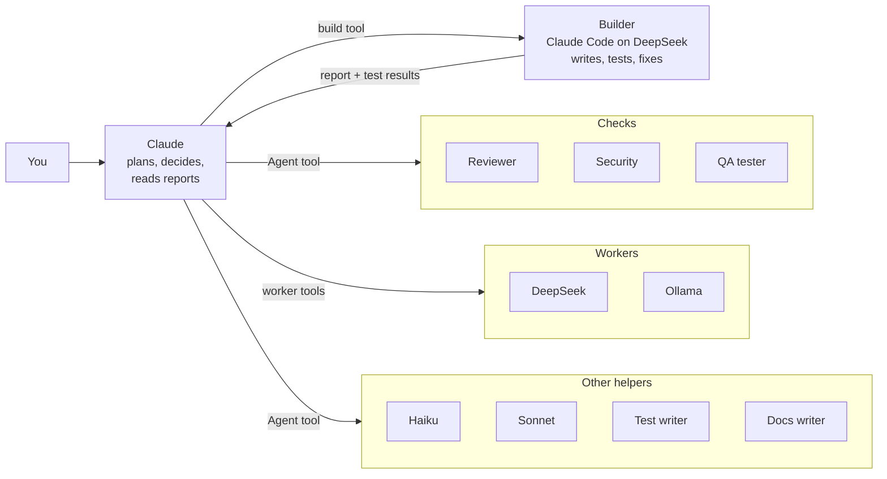
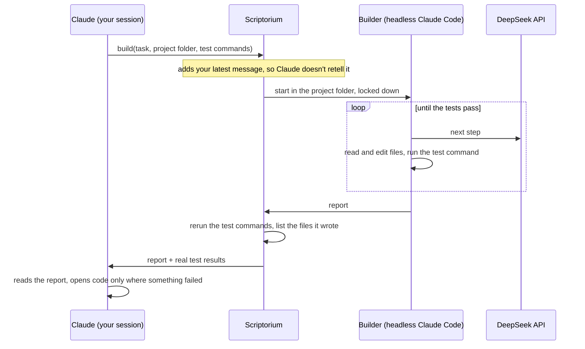

# Scriptorium

A multi-agent workspace for Claude Code. Claude is the head scribe: you talk to it, it plans and decides, and it hands the work to a team of cheaper models, subagents and specialists. Everyone's work shows up live in an isometric, pixel-art office library.


**Why:** to save Claude usage without losing quality. The long write-test-fix loop runs on DeepSeek in a locked-down Claude Code session while Claude only plans and reads a short report; risky changes also get a review with fresh eyes. On the [benchmark](#results), Opus leading the builder passed every hidden test with 38% less Claude usage than Opus alone.

## Quick start

You need [Node.js 22.9+](https://nodejs.org) and a Claude subscription (Pro or Max).

```bash
git clone https://github.com/AkbulutMirac/scriptorium.git
cd scriptorium
npm install
npm run app
```

Open http://localhost:7777. On first launch a **Setup** window walks you through:

1. **Claude account:** "Sign in with Claude" opens Anthropic's sign-in page. Scriptorium brings its own copy of Claude Code.
2. **DeepSeek (optional):** paste an API key from [platform.deepseek.com](https://platform.deepseek.com/api_keys). It is tested, then stored only in `.env` on this computer.
3. **Local models (optional):** install [Ollama](https://ollama.com/download), pull a model (e.g. `ollama pull qwen3.5:9b`) and add it as a worker with one click.
4. **Other Claude Code sessions (optional):** make the team available in your terminal and the Claude desktop app too (see [Outside Scriptorium](#outside-scriptorium)).

Setup can be reopened from the Settings menu. No `.env` is needed: everything has a default.

**Windows shortcut** (runs without a console window, stops from Settings → "Quit Scriptorium"):

```bash
powershell -ExecutionPolicy Bypass -File scripts\CreateShortcut.ps1
```

## The team



| Member | Runs on | Good at | Can it touch files? |
|---|---|---|---|
| **Builder** | Claude Code on DeepSeek V4 Pro, cheap | Building a planned feature or fix end to end: reads the code, writes it, runs the tests, fixes, reports | Only inside the project folder, and it can only run the test commands Claude allows |
| **DeepSeek** Flash / Pro | DeepSeek API, cheap | One self-contained file, summaries, classification; Flash reads images | Writes one file Claude names, nothing else |
| **Local workers** | Ollama on your GPU, free | Short jobs and anything confidential | No |
| **Haiku** | Your Claude subscription | Searching and reading the codebase | Yes |
| **Sonnet** | Your Claude subscription | Changes across several files, running tests | Yes |
| **Test writer** | Sonnet | Writes and runs tests for a change | Test files only |
| **Reviewer** | Opus | Reviews a finished change with fresh eyes | Read-only |
| **QA tester** | Sonnet | Checks the UI in a real browser, verifies each finding | Read-only |
| **Security** | Sonnet + Cloudflare's [security-audit](https://github.com/cloudflare/security-audit-skill) skill | Changes touching input, auth, files, shell, network, secrets | Read-only |
| **Docs writer** | Sonnet | Updates README and docs at the end | Docs only |

**How Claude picks a way for each job** (the helper notes in [docs/CLAUDE-workers.md](docs/CLAUDE-workers.md)):

| Way | When |
|---|---|
| **Yourself** | A few lines, a quick fix, a question, or confidential code (it never goes to DeepSeek) |
| **Builder** | The default for a feature or a fix once Claude knows what to build. Claude reads the report, not the code |
| **Builder + checks** | When a mistake would be costly: core logic, data, many files, a public interface, or anything handling file paths, input, shell, network, logins or secrets. After the builder, the reviewer and (when it applies) security and QA check the result |

You can always name the way yourself ("do it yourself", "use the team", "have it reviewed"). **Every helper ends with a report**, which is its answer to Claude: the builder's says what changed and how the tests went, the reviewer's ends with a verdict (Approve / Changes needed) and must fix, should fix and nits at `file:line`. The **?** button in the top bar shows the three ways in short.

The specialists are plain Claude Code agent files in [`agents/`](agents), easy to read and change.

**Security skill:** the security specialist loads Cloudflare's [security-audit skill](https://github.com/cloudflare/security-audit-skill) when it is installed, and falls back to general secure-coding checks when it isn't. To install it for all projects:

```bash
npx skills add https://github.com/cloudflare/security-audit-skill --skill security-audit --global
```

## How the builder works

Claude hands over a job with one call to Scriptorium's `build` tool (MCP): the task, the project folder and the test commands the builder may run. Scriptorium starts a headless Claude Code session in that folder through the Agent SDK and points it at [DeepSeek's Anthropic-compatible API](https://api-docs.deepseek.com/guides/anthropic_api), so the whole read-write-test loop runs on DeepSeek instead of Claude.



What keeps it safe:

- **No Claude login:** the session starts with a fresh environment (only paths and system basics), the DeepSeek key as its API key and its own empty config folder. Your Claude credentials and settings never reach it.
- **Locked to the folder:** reading and writing work only inside the project folder (links are followed and checked too); `.env` files are off limits.
- **Only the test commands:** the shell runs nothing but the exact commands Claude passed. There is no network and there are no other tools. It never commits.
- **Limits:** 80 turns and 30 minutes per job, and one build per folder at a time.

The report has a fixed shape (Result, Changed, Tests, Failures, Look at, Open), so Claude can read it instead of the code. The builder's instructions are in [`agents/builder.md`](agents/builder.md). While it works, DeepSeek Pro sits at a desk in the office, and its report is kept in DeepSeek Pro's history under "From Claude".

## Results

Opus 5.5 as the only decision maker, on 4 feature tasks, 2 rounds each, graded with hidden tests the agents never saw (see [Benchmark](#benchmark)):

| Setup | Hidden tests | Claude usage | DeepSeek | Time per task |
|---|---|---|---|---|
| Opus alone | 122/122 | $4.89 | – | ~2 min |
| **Opus leads, the builder builds** | **122/122** | **$3.04 (−38%)** | $0.35 | ~3 min |
| Opus leads, the builder builds, reviewer and security check | 119/122 | $6.74 | $0.42 | ~6 min |

- **The builder saves Claude usage at the same quality.** Opus plans, hands over the job and reads a short report; the write-test-fix loop runs on DeepSeek. It takes longer: DeepSeek is slower, and in the benchmark builds also waited for a free slot (4 run at a time).
- **Checks cost more and check more.** With the reviewer (Opus) and the security reviewer (Sonnet) on top, every change is read again by two more agents, so it uses more than Opus alone. They found real bugs the hidden tests don't cover (a whitespace-only line that wasn't skipped, a wrong error position, field names like `constructor` being accepted). The 3 lost tests were a convention the builder got wrong (errors printed to stderr instead of the CLI's output function), which the reviewers didn't flag either.
- With **Sonnet** leading, the builder also saved usage: $0.31 including DeepSeek against $0.52 for Sonnet alone on the two v3 tasks, both 37/37 (one round).

"Claude usage" is the API-equivalent cost that Claude Code reports for each session, including its subagents. On a subscription it is the share of your limits the work takes.

## Benchmark

[`bench/`](bench) measures whether the team really saves Claude usage without losing quality.

- **Project:** a small Node command-line inventory tool ([`bench/fixture`](bench/fixture)).
- **Tasks:** written specs for real features ([`bench/tasks-v2`](bench/tasks-v2), [`bench/tasks-v3`](bench/tasks-v3)): a filter language, strict CSV parsing, order allocation, a file export with security rules, and more.
- **Grading:** each task has hidden tests the agent never sees. Before a task is used, [`bench/check-tasks.ts`](bench/check-tasks.ts) checks that they fail on the untouched project and pass with a reference solution.
- **Setups:** A = Claude alone; C = Claude leads and the builder builds; D = C plus the reviewer and the security reviewer. B is Claude with the team available but not asked for.
- **Cost:** each Claude session's own reported cost, split by model, so other sessions on the account don't mix in. DeepSeek's cost comes from the builder's token counts and DeepSeek's prices. Setups run at the same moment so they see the same prompt cache, and each task runs in a fresh copy of the project.

```bash
npx tsx --env-file-if-exists=.env bench/run.ts --suite v3 --configs A,C,D --model opus --tasks v2/where-filter,csv-strict,allocate,export --label my-run
```

```bash
npx tsx bench/report.ts my-run
```

C and D need Scriptorium running. The report shows hidden tests, cost per model, each build, and the reviewers' verdicts and findings.

## Features

**Chat with Claude**
- Runs on Claude Code: your CLAUDE.md, MCP servers, skills and plugins work as in the terminal.
- Streaming answers, thinking, tool cards with diffs, permission prompts and multiple-choice questions.
- Side chats, quoting replies, a session panel (folder, git changes, context, connectors, background tasks).
- Attach files and images, slash commands, model, effort, fast mode and permission mode under the input.
- Subscription usage limits in the top bar; history grouped by project and shared with your terminal sessions.

**Workers and helpers**
- Chat with any worker, Haiku or Sonnet directly, with images and files, model and thinking settings.
- Every task Claude hands out lands in that helper's history under "From Claude": the task folded to its first lines, then the answer or report.
- Add, edit and remove DeepSeek and Ollama workers from the UI. Confidential tasks (`sensitive`) only go to local workers.
- **QA tools** drive a real headless Edge/Chrome: `qa_sweep` clicks every visible control on desktop, tablet and phone and measures overflow, cut-off text, overlaps, tap targets and console errors; `qa_explore` explores flows on its own. They only test local addresses and never press send, delete, sign-in or quit buttons.

**The office**
- Claude sits at the head desk; workers have their own desks and rest in the lounge when idle.
- Subagents and specialists walk in through the door while they work and leave when done. Several jobs for the same worker show up as several copies.
- Hover over anyone to see their task, project and how long it has been running.
- The bar under the office shows Claude, the helper you picked and whoever is busy; **Team** lists everyone with their status.
- Light, dark or system theme, 6 accent colors and a pixel mode.

## Outside Scriptorium

The team also works in Claude Code sessions in your terminal and the Claude desktop app. In Setup step 4:

- **Worker tools:** registers Scriptorium's MCP server (`http://127.0.0.1:7777/mcp`), which includes `build`.
- **Specialists:** copies the agent files to `~/.claude/agents/scriptorium/`.
- **Office hooks:** adds Claude Code hooks so those sessions' subagents show up in the office and get the report request, and the builder gets your latest message.
- **Helper notes (optional):** adds the notes to `~/.claude/CLAUDE.md`. Sessions opened in Scriptorium always have them.

Scriptorium has to be running for the worker tools: one server keeps the DeepSeek key in one place, gives every session the same local model queue and lets the office see every task. Subagents run inside Claude Code; Scriptorium only follows them through the hooks.

To list the workers in the Claude desktop app under Settings → Desktop app → Local MCP servers, add this to `claude_desktop_config.json` and restart the app:

```json
"mcpServers": {
  "scriptorium": { "command": "npx", "args": ["-y", "mcp-remote", "http://127.0.0.1:7777/mcp"] }
}
```

## Settings (`.env`, all optional)

| Setting | Description |
|---|---|
| `DEEPSEEK_API_KEY` | For DeepSeek workers (Setup writes it for you) |
| `CLAUDE_CODE_PATH` | Path to your own `claude` install. Empty means Scriptorium's own copy. |
| `CLAUDE_CWD` | Claude's default working folder (also changeable in the UI) |
| `PROJECTS_DIR` | Where your project folders live. Listed automatically in the folder picker and history. |
| `PROJECTS_EXCLUDE` | Folders to hide from the lists (names or full paths, comma-separated). Folders are never touched. |
| `OLLAMA_BASE_URL` | If Ollama runs at another address |
| `WORKER_MAX_TOKENS` | Optional cap on output tokens per worker call. Empty: the provider's default. Thinking tokens count too. |
| `PORT` | Backend port (default 7777) |

## Choosing a local model

Local workers get short, single-step tasks. A model is fast when it fits entirely in your GPU memory:

- **8 GB GPU:** `qwen3.5:9b` (6.6 GB) is fast. Stronger but slower: `hf.co/ISTA-DASLab/Qwen3.8-27B-GSQ-RCO-GGUF:IQ2_S` (9.3 GB), about 3.7 tokens/s on an RTX 4060 Laptop.
- **12 GB and up:** 14B–27B models.

For a model you won't send images to, removing Ollama's vision module makes it faster:

```bash
ollama show --modelfile <model> > model.Modelfile
```

Delete the second `FROM` line in `model.Modelfile` (add `PARAMETER num_ctx 16384` for a larger context), then:

```bash
ollama create <new-name> -f model.Modelfile
```

Thinking is off by default for local workers; turn it on from the menu under the worker's input.

## Development

```bash
npm run dev        # http://localhost:5173, the server restarts on code changes
```

```bash
npm run typecheck
```

```bash
npm run cli        # try it from the terminal (/side <message> opens a side chat)
```

Design notes: [docs/PLAN.md](docs/PLAN.md)

## Security

- The backend listens only on this computer (`127.0.0.1`). The WebSocket, MCP and hook endpoints accept requests only from this computer and the app's own origins, so other sites in your browser can't control Claude or the workers.
- API keys live only in `.env`, never go into the repo and are never sent back to the UI.
- In "Ask every time" mode, Claude's commands and file changes wait for your approval in the UI.
- Data sent to DeepSeek goes to DeepSeek's servers, and that includes the code the builder reads. For confidential tasks use `sensitive: true` and a local worker.
- The builder runs without your Claude login, only inside the project folder and only with the test commands Claude allows (see [How the builder works](#how-the-builder-works)). Those test commands run code the builder wrote, with your user's rights and without a sandbox; review the report when it touches anything sensitive.

## License

[MIT](LICENSE)
